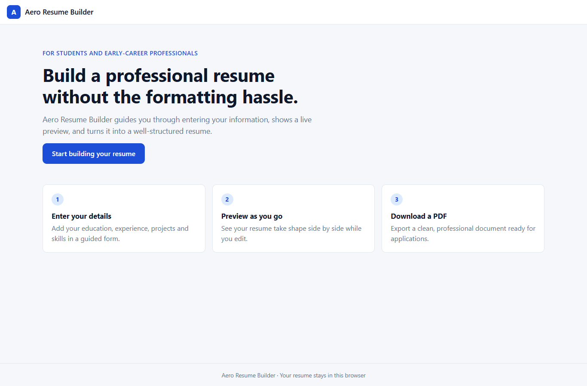
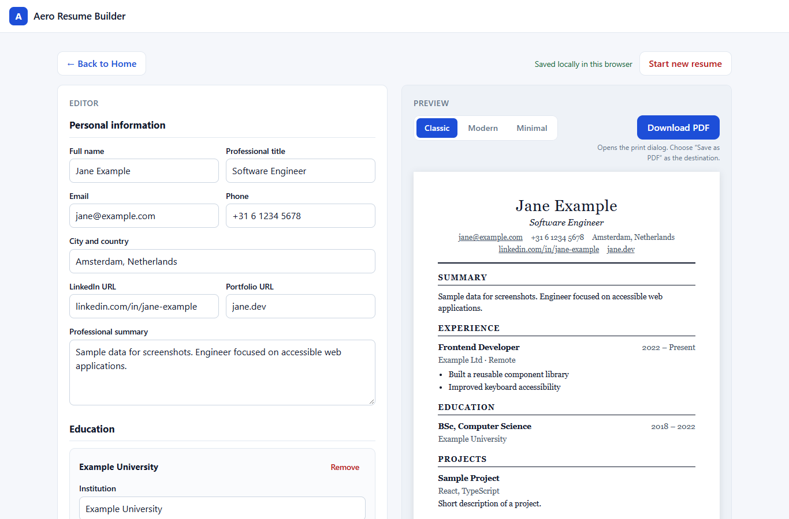
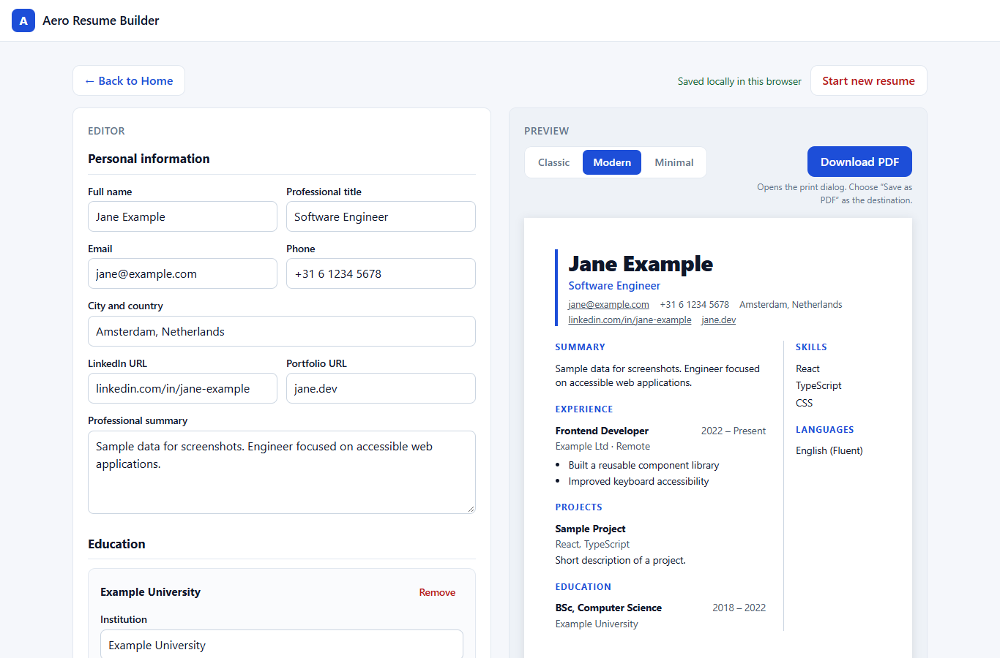
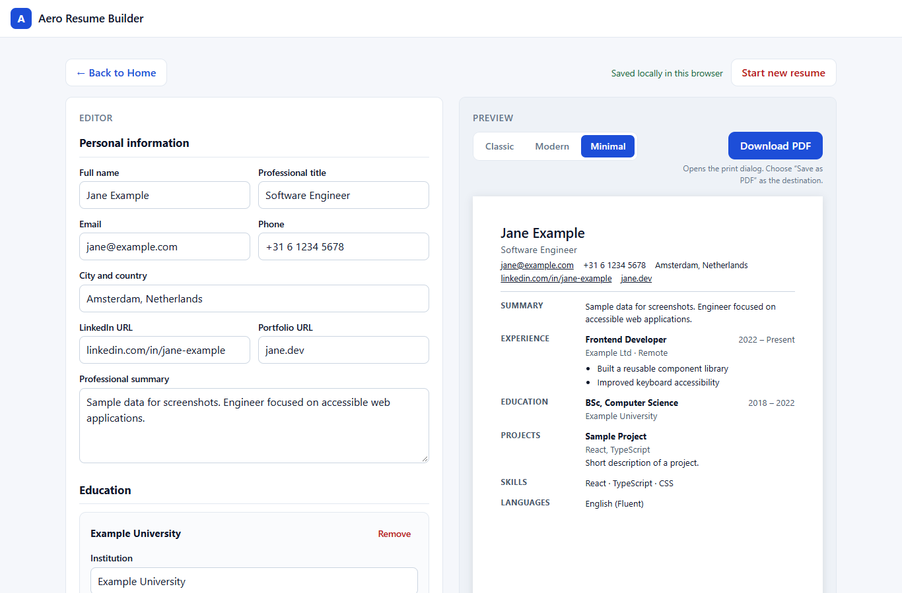

# Aero Resume Builder

**A simple, student-friendly web application for creating professional resumes with less effort.**

Aero Resume Builder is a reconstruction and improvement of a university project originally developed during my B.Tech in Computer Science and Engineering. The project explores how a straightforward, user-friendly interface can help students and early-career professionals create structured, professional resumes without spending excessive time on formatting.

The goal of this iteration is to turn the original concept into a functional, well-documented web application while exploring modern frontend development, usability, and software design.

## Overview

Creating a resume can be unnecessarily time-consuming, particularly for students and recent graduates who may have limited experience with professional resume formatting.

Aero Resume Builder aims to simplify this process by allowing users to enter their information, select a resume template, preview their document, and generate a downloadable PDF.

Rather than requiring users to design a resume from scratch, the application focuses on a guided workflow that makes resume creation more accessible and straightforward.

## Who Is It For?

Aero Resume Builder is intended primarily for:

* University students preparing their first professional resume.
* Recent graduates applying for internships and entry-level positions.
* Early-career professionals who want a straightforward resume creation process.
* Job seekers who prefer structured templates over manually formatting documents.

## Project Objectives

The project aims to:

* Simplify the process of creating a professional resume.
* Provide a clear and intuitive resume editing experience.
* Offer multiple resume templates for different presentation preferences.
* Make resume information easy to enter, review, and update.
* Support PDF export for applications and professional use.
* Explore user-centred design principles in a practical software project.
* Develop a maintainable application through iterative implementation and testing.

## Screenshots

The screenshots below use sample data, not a real person's resume.

| Landing page | Classic template |
| --- | --- |
|  |  |

| Modern template | Minimal template |
| --- | --- |
|  |  |

## Implemented Features

These features are implemented and have been checked as described in [Testing](#testing).

* **Resume editor.** Labelled form fields for:
  * personal information and a professional summary
  * education
  * work experience, with a "currently work here" option
  * projects
  * skills
  * certifications
  * languages, with a proficiency level

  You can add and remove entries in every repeatable section.
* **Live preview.** The resume updates as you type. Empty sections and blank entries are hidden. Before anything is entered, a short message explains what to do.
* **Three templates.** Switching template keeps all entered information.
  * **Classic:** serif typography, centred header and ruled section headings.
  * **Modern:** bold header with an accent bar, plus a side column for skills, languages and certifications.
  * **Minimal:** compact single column with headings in a narrow left column. It avoids colour and graphics, which suits applicant tracking systems (ATS).
* **PDF export.** The *Download PDF* button prints only the resume on A4 pages, in the selected template. See [How PDF export works](#how-pdf-export-works).
* **Automatic local saving.** Every change is saved in the browser and restored when you refresh or reopen the page. See [How local draft saving works](#how-local-draft-saving-works).
* **Start new resume.** Clears the current draft after a confirmation step.
* **Validation:**
  * Email and web addresses are checked only when you fill them in, and errors appear after you leave the field.
  * Errors are announced to screen readers, and your input is never removed.
  * Spaces at the start or end of a single-line field are removed when you leave it.
* **Navigation.** The landing page and the builder (`#/builder`) are separate browser history entries, so the browser Back and Forward buttons work. A *Back to Home* button is also provided.
* **Responsive and keyboard-accessible:**
  * The editor and preview sit side by side on wide screens and stack on narrow ones.
  * All controls work with the keyboard and show a visible focus ring.
  * The template picker uses standard radio buttons, so the arrow keys work.

## Technology Stack

* [React 19](https://react.dev/) with [TypeScript](https://www.typescriptlang.org/)
* [Vite](https://vite.dev/) for the development server and production build
* [Oxlint](https://oxc.rs/) for linting
* [Vitest](https://vitest.dev/) for unit tests
* Plain CSS, with no UI framework

PDF export uses the browser's own print engine, so the project has no PDF library. There is no backend and no external API.

### Project structure

```
src/
  App.tsx                 Screen navigation, resume state, autosave
  resume.ts               Resume data types, templates, list helpers, file name
  storage.ts              Saving/loading the draft in localStorage
  validation.ts           Email and URL checks
  components/
    Header.tsx            App header with the logo and home link
    Welcome.tsx           Landing page
    Workspace.tsx         Toolbar, template picker, editor + preview layout
    EditorPanel.tsx       All editor sections
    ResumePreview.tsx     The resume document (all three templates)
    ClearResumeButton.tsx "Start new resume" with confirmation
    editor/               Form fields and individual editor sections
  *.test.ts               Unit tests
```

All resume data is held in one `Resume` object in `App.tsx`. The editor updates it, and the preview receives it through props.

## Getting Started

You need [Node.js](https://nodejs.org/) (version 20 or later is recommended) and npm.

```bash
npm install        # install dependencies
npm run dev        # start the development server
```

Open the URL that Vite prints, normally <http://localhost:5173/>.

Other commands:

```bash
npm run build      # type-check and create a production build in dist/
npm run preview    # serve the production build locally
npm run lint       # run Oxlint
npm test           # run the unit tests once
```

## How PDF export works

Clicking **Download PDF** opens the browser's print dialog. Choose **Save as PDF** (or **Microsoft Print to PDF**) as the destination.

* Print styles hide everything except the resume: the header, editor, buttons and preview frame are all left out.
* The page size is A4 with 14–15 mm margins.
* Section headings stay with their content. Short entries are kept on one page, and longer experience entries may continue on the next page between bullet points.
* The PDF contains real text, so it can be selected and searched.
* The suggested file name is based on your name, for example `Jane-Doe-Resume.pdf`. Characters that are not safe in file names are removed.

**Why the print dialog instead of a PDF library?** Libraries that turn a screenshot of the page into a PDF produce blurry text that cannot be selected. Libraries that build the PDF themselves would need every template designed a second time. The browser's print engine already lays out the existing HTML and CSS as real, selectable text. The trade-off is one extra step in the print dialog. Also, the result can vary slightly between browsers, and some browsers add their own headers and footers unless *Headers and footers* is turned off in the dialog.

## How local draft saving works

* The resume and the selected template are saved automatically in your browser's `localStorage` after every change. They are restored when the page is refreshed or reopened.
* A small status message shows *Saved locally in this browser*. If storage is blocked (for example in some private browsing modes), it warns that changes will be lost when the tab closes. The app itself keeps working.
* Saved data is checked when it is loaded:
  * If parts are damaged, the usable parts are kept.
  * If the draft cannot be read at all, the app starts with an empty resume and shows a notice. A copy of the unreadable data is kept under a separate key, so it is not overwritten silently.
* **Start new resume** asks for confirmation and then deletes the saved draft.

## Privacy

* Your resume stays in your browser. The app does not send resume data to any server, and it has no analytics, accounts or AI services.
* Saved drafts exist only in the browser and on the device where you created them. They are lost if you clear your browser's site data, and they are not available in another browser or on another device.
* Anyone with access to your browser profile can open the saved draft. On a shared computer, use **Start new resume** when you are finished.

## Testing

### Automated unit tests

`npm test` runs 25 unit tests with Vitest:

* **`src/resume.test.ts`:**
  * adding, removing and updating entries
  * unique IDs
  * the empty resume
  * template IDs
  * the PDF file name: removing unsafe characters and accents, and the fallback name
* **`src/validation.test.ts`:** valid and invalid email addresses and URLs, and optional empty values.
* **`src/storage.test.ts`:**
  * saving and restoring a draft
  * empty storage
  * clearing the draft
  * blocked storage that throws errors
  * invalid JSON, which is backed up
  * partly damaged data, which is repaired

Last run on 27 October 2026: **3 test files, 25 tests passed.** `npm run build` and `npm run lint` also completed without errors or warnings.

The unit tests cover the logic only. There are no automated component tests in the repository yet.

### Browser checks performed during development

These checks used a temporary script that is not part of this repository. It drove Microsoft Edge in headless mode on Windows, and every check passed with no console errors. It checked that:

* The full user journey works:
  * the landing page leads to the builder
  * every section can be filled in
  * entries can be added and removed
  * the live preview updates
  * all three templates can be selected
  * a refresh restores the draft
  * the export button works
  * Back to Home, browser Back and Forward, and returning to the editor work
  * *Start new resume* works, including cancelling with the Escape key
* Validation messages appear, `aria-invalid` is set, and the input is preserved.
* An unreadable saved draft shows the notice and is backed up.
* With `localStorage` blocked, the app still works and shows a warning.
* There is no horizontal scrolling at 1366 px and 375 px widths.

For PDF output, short, fully populated and long (multi-page) resumes were generated in each template with Edge's print engine, the same engine used by *Save as PDF*. All nine PDFs had these properties:

* A4 size
* selectable text containing the expected content
* no app interface text
* no blank pages

The long resumes were 3–4 pages. The rendered pages were also inspected visually for overlapping or clipped text and for headings left alone at the bottom of a page.

### Manual checklist

1. Fill in every section, then refresh. Everything should still be there.
2. Switch between Classic, Modern and Minimal. The data should stay the same and the layout should change.
3. Click **Download PDF**, choose *Save as PDF*, and open the file. It should contain only the resume, on A4 pages.
4. Enter an invalid email such as `jane@example`, then leave the field. An error should appear.
5. Click **Start new resume**, then **Cancel**, and check that nothing was deleted. Then confirm, and check that the resume is cleared.
6. Use **Back to Home** and the browser Back and Forward buttons.

## Known Limitations

* PDF export depends on the browser's print dialog. Output was verified in Microsoft Edge (Chromium). Firefox and Safari have not been tested and may paginate slightly differently.
* Some browsers add their own date, title and URL to printed pages unless *Headers and footers* is turned off in the print dialog.
* Only one resume draft is stored at a time. There is no export or import of the draft as a file.
* Dates are free text, so the app does not check their format or order.
* The draft is not synchronised between devices. This is intentional: there is no backend.
* The app is only run locally and has not been deployed.

## Project Background

The original Aero Resume Builder was developed as a university group project between April and August 2022 at Rajagiri School of Engineering & Technology.

I worked as a full-stack developer and team lead in a three-member team. The original project focused on simplifying resume creation through template selection, user-entered information, and PDF generation.

This repository represents a reconstruction and improvement of that earlier project. It is an opportunity to revisit the original concept, refine the user experience, and explore contemporary development practices.

The current implementation should be considered separate from the original source code unless otherwise explicitly documented.

## Development Approach

Development is being approached iteratively, with an emphasis on building and verifying the core user journey before introducing additional complexity.

The main priorities are:

1. Establish a clear and maintainable application structure.
2. Implement the resume editing workflow.
3. Develop distinct templates and a functional preview.
4. Implement and test PDF generation.
5. Improve usability, validation, and draft persistence.
6. Document the setup process, implementation decisions, and known limitations.

Features will be documented according to their actual implementation and testing status.

## Current Status

**Status: Working MVP, run locally. Not deployed.**

The core journey works: editing a resume, live preview, three templates, PDF export through the browser, automatic local saving and validation. The features are listed under [Implemented Features](#implemented-features), and how they were checked is described under [Testing](#testing).

## Future Improvements

Potential future enhancements include:

* Additional resume templates.
* Reordering entries and sections (for example by drag and drop, with a keyboard alternative).
* Exporting and importing the draft as a file, and keeping several drafts.
* Structured date input with checks on date order.
* Automated component and end-to-end tests in the repository.
* Testing PDF output in Firefox and Safari.
* Optional AI-assisted writing features, subject to a clear implementation and privacy considerations.

These are potential extensions rather than claims about existing functionality.

## Learning Objectives

Through this project, I aim to strengthen my practical understanding of:

* Frontend application development.
* User interface design and usability.
* Requirements analysis and feature prioritisation.
* Software testing and iterative improvement.
* Version control using Git and GitHub.
* Technical documentation and project maintenance.
